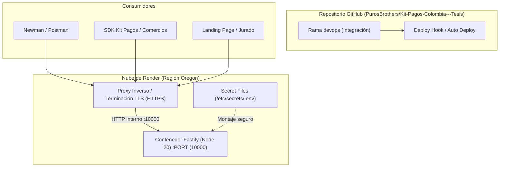

# Despliegue en Render y Colección Postman: Guía de Operación y Verificación

Este documento explica cómo está desplegada la **API de Simulación** en Render, cómo funciona su infraestructura como código, cómo se gestionan los secretos y cómo se verifica el servicio completo mediante la colección de Postman y Newman.

Corresponde a la implementación y cierre del **Issue #131** (PR #147), que completa el primer entregable de la Iteración 3 de la metodología de tesis: *API de Simulación completa: escenarios de fallo, despliegue en la nube y colección Postman versionada*.

---

## 1. Resumen ejecutivo del entorno

| Parámetro | Detalle en Render |
|---|---|
| **Servicio** | Web Service en [Render](https://render.com/) |
| **Nombre del servicio** | `kit-pagos-colombia` |
| **URL pública** | [`https://kit-pagos-colombia.onrender.com`](https://kit-pagos-colombia.onrender.com) |
| **Documentación OpenAPI / Swagger** | [`https://kit-pagos-colombia.onrender.com/docs`](https://kit-pagos-colombia.onrender.com/docs) |
| **Healthcheck nativo** | [`https://kit-pagos-colombia.onrender.com/health`](https://kit-pagos-colombia.onrender.com/health) (HTTP 200 `{"status":"ok"}`) |
| **Rama de despliegue** | `devops` |
| **Runtime y versión** | Node.js 20.x |
| **Directorio raíz (`rootDir`)** | `simulator-api` |
| **Comando de construcción** | `npm ci && npm run build` |
| **Comando de arranque** | `npm start` |
| **Colección de Postman** | [`simulator-api/postman/kit-pagos-simulator.postman_collection.json`](../../simulator-api/postman/kit-pagos-simulator.postman_collection.json) (41 peticiones, 100% aprobadas con Newman contra el simulador local el 15 de octubre de 2026) |

---

## 2. Arquitectura de despliegue en Render

El despliegue está formalizado como Infraestructura como Código (IaC) mediante el Blueprint [`render.yaml`](../../render.yaml) en la raíz del repositorio.



### 2.1. El Blueprint (`render.yaml`)

El archivo define de forma declarativa la configuración del servicio:

```yaml
services:
  - type: web
    name: kit-pagos-colombia
    runtime: node
    plan: free
    region: oregon
    rootDir: simulator-api
    buildCommand: npm ci && npm run build
    startCommand: npm start
    healthCheckPath: /health
    autoDeploy: true
    envVars:
      - key: NODE_VERSION
        value: 20.x
      - key: PORT
        value: 10000
      - key: SIMULATOR_SDK_BASE_URL
        value: https://kit-pagos-colombia.onrender.com
      - key: SIMULATOR_PUBLIC_ORIGIN
        value: https://kit-pagos-colombia.onrender.com
      - key: SIMULATOR_TRUST_FORWARDED_FOR
        value: "true"
      # Render pide los valores con sync: false solo al crear el Blueprint; en un servicio
      # que ya existe los ignora, y una variable nueva se agrega a mano en el panel.
      - key: API_AUTH_TOKEN
        sync: false
      - key: WOMPI_PUBLIC_KEY
        sync: false
      # ... el resto de las credenciales de pasarela, todas con sync: false
```

Las claves con `sync: false` son exactamente los secretos que lee el servidor, con los nombres que usa el código (sección 4.4). Render pide su valor solo durante la creación inicial del Blueprint; al actualizar un Blueprint existente las ignora, y una credencial nueva se agrega a mano en el servicio ([render.com/docs/blueprint-spec](https://render.com/docs/blueprint-spec), «Prompting for secret values», consultada el 15 de octubre de 2026). Por eso un cambio de nombre en `render.yaml` no llega solo al servicio desplegado: el panel se revisa a mano. Hasta el 15 de octubre de 2026 el archivo declaraba `WOMPI_WEBHOOK_SECRET`, `RAPYD_ACCESS_KEY`, `RAPYD_SECRET_KEY` y `RAPYD_WEBHOOK_SECRET`, que el código no lee; los nombres que lee son `WOMPI_EVENTS_SECRET`, `RAPYD_API_ACCESS_KEY` y `RAPYD_API_SECRET_KEY`, y Rapyd no tiene un secreto de webhooks aparte: `CredentialResolver` usa `RAPYD_API_SECRET_KEY` para verificarlos. Si el panel todavía tiene los nombres viejos, esos valores no se usan.

### 2.2. El puerto y la interfaz

`render.yaml` fija `PORT` en `10000`. `simulator-api/src/server.ts` escucha donde indica `listenAddress()`, de `src/serverAddress.ts`:

```typescript
const address = listenAddress();

const app = buildApp({ logger: fastifyLoggerConfig });

app.listen(address).catch((error) => {
  app.log.error(error);
  process.exit(1);
});
```

`listenAddress()` toma `PORT` y `HOST` de `loadServerEnv()`, como las demás variables (sección 4.2). Sin valor, son `3000` y `0.0.0.0` (todas las interfaces). Del mismo `serverPort()` salen las URL que la API arma hacia sí misma cuando no hay `SIMULATOR_SDK_BASE_URL` (`KitPagosProvider`) y el origen de respaldo de la URL del banco de Wompi (`BankRedirectOrigins`), así que nunca difieren del puerto en el que escucha. Un `PORT` que no es un entero entre 1 y 65535 detiene el arranque con «PORT debe ser un entero entre 1 y 65535». Un `PORT` vacío cuenta como ausente: con `Number("")`, que es 0, Fastify escucharía en un puerto al azar.

### 2.3. Terminación TLS y `SIMULATOR_PUBLIC_ORIGIN`

Render actúa como un reverse proxy que termina el cifrado TLS en el borde y reenvía la petición al contenedor en `http://`.

Para evitar que las URLs generadas por el simulador (como las páginas de banco del PSE de las cuatro pasarelas, el checkout de Rapyd o el permalink de términos de Wompi) salgan con el protocolo interno `http://`, la variable `SIMULATOR_PUBLIC_ORIGIN` fija el prefijo canónico:

```env
SIMULATOR_PUBLIC_ORIGIN=https://kit-pagos-colombia.onrender.com
```

Al arrancar, `parsePublicOrigin()` valida que el valor sea una URL válida con protocolo HTTP/HTTPS, sin credenciales incrustadas y sin ruta. Esto garantiza que todos los enlaces retornados al SDK o a los navegadores utilicen HTTPS seguro.

---

## 3. Estrategia de ramas y despliegue continuo (CI/CD)

### 3.1. Rama base `devops`

Siguiendo la política de contribución del proyecto ([CONTRIBUTING.md](../../CONTRIBUTING.md)), el servicio en Render está enlazado a la rama `devops`, no a `main`:
1. El desarrollo se realiza en ramas de características (`feat/...`, `docs/...`).
2. Se abre Pull Request hacia `devops`.
3. Al aprobarse e integrarse el PR, Render detecta el commit en `devops` y dispara la compilación y despliegue automático.

### 3.2. Deploy Hook para despliegue automatizado

Render expone un **Deploy Hook** (URL con token único) que permite forzar el redespliegue sin ingresar a la interfaz gráfica:

```bash
curl -X POST "$RENDER_DEPLOY_HOOK_URL"
```

Esta variable está documentada en `.env.example` (`RENDER_DEPLOY_HOOK_URL`). Permite coordinar despliegues desde scripts de mantenimiento o desde flujos de GitHub Actions.

---

## 4. Gestión de credenciales y modo abierto

### 4.1. Cero credenciales en el repositorio

El repositorio cumple de forma estricta la regla de no versionar secretos reales:
- Todos los archivos `.env` locales están ignorados en `.gitignore`.
- En `render.yaml`, todas las credenciales sensibles están marcadas con `sync: false`.

### 4.2. De dónde lee la configuración: los archivos `.env`, el Secret File y el entorno

Render permite configurar un **Secret File**. En tiempo de ejecución queda en `/etc/secrets/<nombre>` y, en los servicios que no usan Docker, también en el directorio raíz del servicio ([render.com/docs/configure-environment-variables](https://render.com/docs/configure-environment-variables), consultada el 15 de octubre de 2026). Con el nombre `.env`, la API lo lee.

`CredentialResolver.loadServerEnv()` no usa `dotenv`. Recorre estas rutas en orden y lee **todas** las que existen, no solo la primera:

```typescript
const candidatePaths = [
  path.resolve(__dirname, "../../../.env"), // Raíz del repositorio
  path.resolve(process.cwd(), ".env"),      // Directorio desde el que arranca el proceso
  path.resolve(process.cwd(), "../.env"),   // Su directorio padre
  "/etc/secrets/.env",                      // Secret File de Render
];
```

De cada archivo toma las líneas `CLAVE=valor`: omite las vacías, las que empiezan con `#` y las que no tienen `=`, separa en el primer `=` y recorta los espacios de la clave y del valor. No quita comillas ni comentarios al final de la línea, a diferencia de `dotenv`. De cada clave se queda con **el primer valor que encuentra** en ese orden, aunque esté vacío: una línea `CLAVE=` en un archivo anterior tapa el valor de esa clave en uno posterior. Al final devuelve `{ ...archivos, ...process.env }`, así que **una variable del entorno del proceso gana sobre todos los archivos**.

La consecuencia en Render es que una variable de la sección «Environment» del servicio, incluidas las que declara `render.yaml`, gana sobre el Secret File. Si las dos fuentes traen la misma clave, el valor del Secret File no se usa. Por ejemplo, `SIMULATOR_TRUST_FORWARDED_FOR` viene en `"true"` desde `render.yaml`, y ponerla en otro valor en el Secret File no la cambia. No se comprobó si Render guarda una variable de «Environment» con el valor vacío; si lo hiciera, ese valor vacío también taparía el del Secret File, y en una credencial la pasarela se quedaría sin ella.

En local aplica lo mismo: con un `.env` en la raíz del repositorio y otro en `simulator-api/`, arrancando desde `simulator-api/`, gana el de la raíz en cada clave que traigan los dos, y lo exportado en la terminal gana sobre ambos. `PORT` y `HOST` siguen la misma regla (sección 2.2).

### 4.3. Modo Abierto en Render para evaluación pública

Por decisión de diseño de la tesis (punto 88 del `architecture-log.md`), en Render la variable `API_AUTH_TOKEN` se mantiene **sin configurar**:
- **Fundamento:** La API de Simulación desplegada es un artefacto de acceso público para que evaluadores, miembros del jurado, la landing page y pruebas externas puedan consumir tanto `/v1/sim` como `/v1/api` y el trigger de webhooks sin requerir tokens Bearer privados ni credenciales estáticas.
- **Comportamiento en código (`authHook.ts`):** Cuando `API_AUTH_TOKEN` no está definido en el entorno, el hook de autenticación emite una advertencia en el log de inicio y deja el acceso abierto sin exigir la cabecera `Authorization: Bearer <token>`.
- **Aislamiento en pruebas unitarias:** En `NODE_ENV === "test"`, `authHook.ts` ignora deliberadamente cualquier `API_AUTH_TOKEN` privado presente en el `.env` local del desarrollador, asegurando que las suites de prueba unitarias corran en modo abierto hermético.

### 4.4. Las variables que lee el servidor

Son todas las que lee `simulator-api/src` (`process.env` y `loadServerEnv()`), contadas el 15 de octubre de 2026. `.env.example` las documenta todas. `render.yaml` declara los secretos con `sync: false` y fija los valores que no son secretos y que en Render tienen que ser distintos de los de omisión; `NODE_VERSION` también está allí, pero la lee Render y no el servidor. Las que no aparecen en `render.yaml` usan su valor por omisión.

| Variable | En `render.yaml` | Para qué |
|---|---|---|
| `PORT`, `HOST` | `PORT` = `10000` | Puerto e interfaz de escucha; del mismo `PORT` salen las URL que la API arma hacia sí misma (sección 2.2) |
| `SIMULATOR_SDK_BASE_URL` | La URL de Render | A dónde apunta el SDK en el ambiente `simulator` |
| `SIMULATOR_PUBLIC_ORIGIN` | La URL de Render | Origen de las URL que el simulador entrega (sección 2.3) |
| `SIMULATOR_TRUST_FORWARDED_FOR` | `"true"` | La IP del pagador sale de `X-Forwarded-For` (punto 92) |
| `API_AUTH_TOKEN` (o `SIMULATOR_API_AUTH_TOKEN`) | `sync: false`, sin valor a propósito (sección 4.3) | Token Bearer de `/v1/api` y del trigger de webhooks |
| `WOMPI_PUBLIC_KEY`, `WOMPI_PRIVATE_KEY`, `WOMPI_INTEGRITY_SECRET`, `WOMPI_EVENTS_SECRET` | `sync: false` | Perfil de Wompi: llaves, firma de integridad y verificación de eventos |
| `MERCADOPAGO_PUBLIC_KEY`, `MERCADOPAGO_ACCESS_TOKEN`, `MERCADOPAGO_WEBHOOK_SECRET` | `sync: false` | Perfil de Mercado Pago |
| `KUSHKI_PUBLIC_MERCHANT_ID`, `KUSHKI_PRIVATE_MERCHANT_ID`, `KUSHKI_WEBHOOK_SECRET` (o `KUSHKI_WEBHOOK_SIGNATURE_ID`, si `KUSHKI_WEBHOOK_SECRET` falta o está vacía) | `sync: false` | Perfil de Kushki |
| `RAPYD_API_ACCESS_KEY`, `RAPYD_API_SECRET_KEY`, `RAPYD_WEBHOOK_URL` | `sync: false` | Perfil de Rapyd; el `secret_key` firma las peticiones y verifica los webhooks |
| `SIMULATOR_WEBHOOK_TARGET_URL`, `SIMULATOR_WEBHOOK_AUTO`, `SIMULATOR_WEBHOOK_TIMEOUT_MS` | No | Salida de webhooks; sin destino no sale ninguno |
| `WEBHOOK_TOLERANCE_SECONDS` | No | Ventana contra reenvíos de `POST /v1/api/webhooks/:gateway` (300 s por omisión) |
| `SIMULATOR_SLOW_RESPONSE_MS` | No | Espera del escenario `SLOW` (35 000 ms por omisión) |

Los nombres entre paréntesis son alias que el código acepta y `render.yaml` no declara, para que una misma credencial no tenga dos valores posibles. `NODE_ENV` también se lee, pero solo para que las pruebas (`NODE_ENV=test`) no usen el `API_AUTH_TOKEN` de los archivos; no es configuración del servicio.

---

## 5. La colección de Postman versionada

La colección vive en [`simulator-api/postman/`](../../simulator-api/postman/) y cubre la totalidad de los endpoints expuestos por la API de Simulación.

### 5.1. Estructura de las 7 carpetas

La colección cuenta con **41 peticiones** diseñadas para ejecutarse en orden:

```text
simulator-api/postman/
├── kit-pagos-simulator.postman_collection.json  # 41 peticiones
├── local.postman_environment.json               # Apunta a http://localhost:3000
├── render.postman_environment.json              # Apunta a https://kit-pagos-colombia.onrender.com
└── README.md                                    # Instrucciones detalladas de uso
```

| Carpeta | Endpoints | Descripción |
|---|---|---|
| **00. Diagnóstico** | `GET /health` | Valida que el servidor esté vivo (HTTP 200). |
| **01. Capa REST Kit Pagos (/v1/api)** | `GET /v1/api/gateways`<br>`POST /v1/api/payments`<br>`GET /v1/api/payments/:id`<br>`GET /v1/api/pse-banks` | Ejercita el SDK expuesto como API REST. Crea un pago con Wompi, consulta su estado y consulta los bancos PSE. |
| **02. Wompi (/v1/sim/wompi)** | `GET /merchants/:publicKey`<br>`GET /terms`<br>`GET /pse/financial_institutions`<br>`GET /pse/redirect`<br>`POST /tokens/cards`<br>`POST /transactions`<br>`GET /transactions/:id` | Simula la API nativa de Wompi. `POST /transactions` incluye un script pre-request que calcula la firma de integridad SHA-256 en tiempo real. `GET /pse/redirect` es la página de banco del PSE. |
| **03. Mercado Pago (/v1/sim/mercadopago)** | `GET /payment_methods`<br>`POST /card_tokens`<br>`POST /payments`<br>`GET /payments/:id`<br>`GET /card_tokens/:id`<br>`GET /payment_methods/search`<br>`POST /orders` (tarjeta, `APRO`)<br>`POST /card_tokens` (titular `OTHE`)<br>`POST /orders` (tarjeta, `OTHE`)<br>`POST /orders` (PSE)<br>`GET /orders/:id`<br>`GET /payments/:paymentId/bank_transfer` | Simula los dos caminos de tarjeta, las órdenes de PSE y el catálogo de medios de pago. La tarjeta del SDK 0.5.0 va por `POST /payments`; la del 0.6.0 lee el BIN del token, busca la marca y el tipo, y crea la orden: aprobada con `APRO` (`201 processed`) y rechazada con `OTHE`, que comprueba el `402` medido con la orden `failed` en `data`. El `POST /orders` de PSE guarda en `mpBankPaymentId` el id numérico de la URL del banco, y la última petición abre esa página. |
| **04. Rapyd (/v1/sim/rapyd)** | `GET /payment_methods/country`<br>`POST /customers`<br>`POST /payments`<br>`GET /payments/:paymentId`<br>`GET /complete-bank-payment`<br>`POST /checkout`<br>`GET /checkout/:checkoutId`<br>`GET /checkout/:checkoutId/pay` | Simula el checkout hospedado, los pagos y la página de banco del PSE. Las rutas de API calculan en su pre-request las cabeceras `salt`, `timestamp` y la firma HMAC-SHA256 Base64; las dos páginas (`/pay` y `/complete-bank-payment`) no llevan firma. |
| **05. Kushki (/v1/sim/kushki)** | `GET /transfer/v1/bankList`<br>`POST /transfer/v1/tokens`<br>`POST /transfer/v1/init`<br>`GET /transfer/v1/status/:token`<br>`GET /transfer/v1/agent`<br>`POST /card/v1/charges`<br>`GET /charges/:ticketNumber` | Simula la transferencia PSE (banco, token, inicio, estado y la página de banco `/agent`) y los cargos con tarjeta. |
| **06. Webhooks** | `POST /v1/sim/webhooks/trigger`<br>`POST /v1/api/webhooks/wompi` | El trigger genera un webhook sintético firmado criptográficamente de la transacción de Wompi creada en la carpeta 02, y el segundo endpoint lo verifica usando el verificador real del SDK. |

### 5.2. Encadenamiento dinámico de identificadores

Para no depender de datos estáticos quemados, la colección captura dinámicamente los identificadores producidos por el servidor y los propaga entre solicitudes:

```javascript
// En el script de prueba de POST /v1/sim/wompi/transactions:
var response = pm.response.json();
if (response.data && response.data.id) {
    pm.environment.set("wompiTransactionId", response.data.id);
}

// En el GET /v1/sim/wompi/transactions/:id:
// La URL utiliza: {{baseUrl}}/v1/sim/wompi/transactions/{{wompiTransactionId}}
```

El mismo encadenamiento se aplica a `mpPaymentId`, `mpCardToken`, `mpCardBin`, `mpCardBrand`, `mpCardType`, `mpCardTokenOthe`, `mpCardOrderId`, `mpOrderId`, `mpBankPaymentId`, `rapydCheckoutId`, `rapydPaymentId`, `kushkiChargeTicket` y `kushkiTransferToken`.

### 5.3. Firmas criptográficas dinámicas en Pre-requests

Desde el punto 86 del `architecture-log.md`, el simulador exige validación criptográfica exacta de firmas, imitando a las pasarelas reales:
- **Wompi:** La petición `POST /transactions` calcula la firma SHA-256 en hexadecimal concatenando `reference + amount_in_cents + currency + integritySecret`:
  ```javascript
  var rawString = reference + amountInCents + currency + secret;
  var signature = CryptoJS.SHA256(rawString).toString(CryptoJS.enc.Hex);
  ```
- **Rapyd:** Las peticiones de la carpeta 04 calculan el `salt` (16 caracteres aleatorios), el `timestamp` (segundos UNIX actuales) y la firma HMAC-SHA256 en Base64 sobre `http_method + path + salt + timestamp + access_key + secret_key + body`:
  ```javascript
  var toSign = httpMethod + path + salt + timestamp + accessKey + secretKey + bodyString;
  var hash = CryptoJS.HmacSHA256(toSign, secretKey);
  var signature = CryptoJS.enc.Base64.stringify(hash);
  ```

---

## 6. Ejecución y validación con Newman

Newman permite ejecutar la colección de forma automatizada y desatendida desde la línea de comandos, actuando como prueba de humo y validación de contrato contra cualquier entorno.

### 6.1. Ejecución contra el simulador local

```bash
npx newman run simulator-api/postman/kit-pagos-simulator.postman_collection.json \
  -e simulator-api/postman/local.postman_environment.json
```

### 6.2. Ejecución contra Render

```bash
npx newman run simulator-api/postman/kit-pagos-simulator.postman_collection.json \
  -e simulator-api/postman/render.postman_environment.json
```

Si el servidor remoto tuviese configurados secretos específicos distintos a los valores por omisión de `merchantSecrets.ts`, se inyectan en línea mediante `--env-var` sin escribirlos en el disco:

```bash
npx newman run simulator-api/postman/kit-pagos-simulator.postman_collection.json \
  -e simulator-api/postman/render.postman_environment.json \
  --env-var "wompiIntegritySecret=mi_secreto_wompi" \
  --env-var "rapydSecretKey=mi_secreto_rapyd"
```

### 6.3. Reporte de ejecución contra Render (Medición en vivo)

Resultado certificado ejecutado sobre `https://kit-pagos-colombia.onrender.com`. Fue una corrida de 33 peticiones, anterior a las tres de las páginas de banco del PSE y a las cinco de la tarjeta de Mercado Pago por la Orders API (issue #109). Con las 41 actuales solo se corrió el simulador local, no Render: el 15 de octubre de 2026, contra un simulador levantado desde el código del issue en `127.0.0.1` y sin `.env`, 41 de 41 peticiones y 44 de 44 aserciones, con la verificación de `POST /v1/api/webhooks/wompi` omitida porque ese servidor no tenía secreto de eventos. Antes, el 14 de octubre de 2026, 36 de 36:

```text
┌─────────────────────────┬─────────────────────┬─────────────────────┐
│                         │            executed │              failed │
├─────────────────────────┼─────────────────────┼─────────────────────┤
│              iterations │                   1 │                   0 │
├─────────────────────────┼─────────────────────┼─────────────────────┤
│                requests │                  33 │                   0 │
├─────────────────────────┼─────────────────────┼─────────────────────┤
│            prerequests │                  33 │                   0 │
├─────────────────────────┼─────────────────────┼─────────────────────┤
│              testScripts │                  33 │                   0 │
├─────────────────────────┼─────────────────────┼─────────────────────┤
│              assertions │                  33 │                   0 │
├─────────────────────────┼─────────────────────┼─────────────────────┤
│   total run duration: 7.9s                                          │
├─────────────────────────────────────────────────────────────────────┤
│ total data received: 8.68KB (approx)                                │
├─────────────────────────────────────────────────────────────────────┤
│ average response time: 234ms [min: 196ms, max: 303ms, s.d.: 24ms]   │
└─────────────────────────────────────────────────────────────────────┘
```

**Resultado:** 33 de 33 peticiones exitosas, 0 fallidas, 33 de 33 aserciones cumplidas. Código de salida: `0`.

---

## 7. Preguntas frecuentes y solución de problemas

### ¿Por qué Render responde lento en la primera petición después de un tiempo inactivo?
El servicio utiliza el plan gratuito (*Free tier*) de Render. Si no recibe peticiones durante 15 minutos, el contenedor entra en suspensión para ahorrar recursos. La primera petición subsiguiente despierta el contenedor (*cold start*), lo que toma aproximadamente entre 30 y 50 segundos. Una vez activo, las respuestas promedio toman entre 180 ms y 250 ms.

### ¿Por qué la ruta de Rapyd `/v1/sim/rapyd/checkout/:id/pagar` responde HTTP 308?
Siguiendo las convenciones internacionales de código y el punto 86 del `architecture-log.md`, la ruta de pago pasó de `/pagar` a `/pay`. Para mantener retrocompatibilidad con clientes existentes, `/pagar` emite una redirección permanente (`308 Permanent Redirect`) hacia `/pay`.

### ¿Qué ocurre si el trigger de webhooks responde `409 WEBHOOK_TARGET_NOT_CONFIGURED`?
Es el comportamiento esperado cuando `SIMULATOR_WEBHOOK_TARGET_URL` no está definida en el entorno. En ese caso, el simulador genera el webhook con su cuerpo nativo y su firma calculada y lo devuelve directamente en la respuesta HTTP, permitiendo verificar el contenido criptográfico sin necesidad de levantar un servidor receptor externo.
