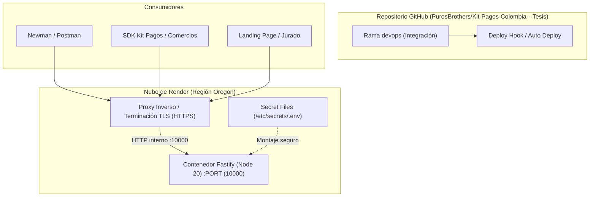

# Despliegue en Render y Colección Postman: Guía de Operación y Verificación

Este documento explica cómo está desplegada la **API de Simulación** en Render, cómo funciona su infraestructura como código, cómo se gestionan los secretos y cómo se verifica el servicio completo mediante la colección de Postman y Newman.

Corresponde a la implementación y cierre del **Issue #131** (PR #147), que completa el primer entregable de la Iteración 3 de la metodología de tesis: *API de Simulación completa: escenarios de fallo, despliegue en la nube y colección Postman versionada*.

---

## 1. Resumen ejecutivo del entorno

| Parámetro | Detalle en Render |
|---|---|
| **Servicio** | Web Service en [Render](https://render.com/) |
| **Nombre del servicio** | `kit-pagos-colombia` |
| **URL pública** | [`https://kit-pagos-colombia.onrender.com`](https://kit-pagos-colombia.onrender.com) |
| **Documentación OpenAPI / Swagger** | [`https://kit-pagos-colombia.onrender.com/docs`](https://kit-pagos-colombia.onrender.com/docs) |
| **Healthcheck nativo** | [`https://kit-pagos-colombia.onrender.com/health`](https://kit-pagos-colombia.onrender.com/health) (HTTP 200 `{"status":"ok"}`) |
| **Rama de despliegue** | `devops` |
| **Runtime y versión** | Node.js 20.x |
| **Directorio raíz (`rootDir`)** | `simulator-api` |
| **Comando de construcción** | `npm ci && npm run build` |
| **Comando de arranque** | `npm start` |
| **Colección de Postman** | [`simulator-api/postman/kit-pagos-simulator.postman_collection.json`](../../simulator-api/postman/kit-pagos-simulator.postman_collection.json) (33 peticiones, 100% aprobadas con Newman) |

---

## 2. Arquitectura de despliegue en Render

El despliegue está formalizado como Infraestructura como Código (IaC) mediante el Blueprint [`render.yaml`](../../render.yaml) en la raíz del repositorio.



### 2.1. El Blueprint (`render.yaml`)

El archivo define de forma declarativa la configuración del servicio:

```yaml
services:
  - type: web
    name: kit-pagos-colombia
    runtime: node
    plan: free
    region: oregon
    rootDir: simulator-api
    buildCommand: npm ci && npm run build
    startCommand: npm start
    healthCheckPath: /health
    autoDeploy: true
    envVars:
      - key: NODE_VERSION
        value: 20.x
      - key: PORT
        value: 10000
      - key: SIMULATOR_SDK_BASE_URL
        value: https://kit-pagos-colombia.onrender.com
      - key: SIMULATOR_PUBLIC_ORIGIN
        value: https://kit-pagos-colombia.onrender.com
      # Variables de pasarela con sync: false (nunca se guardan en el repo)
      - key: API_AUTH_TOKEN
        sync: false
      - key: WOMPI_INTEGRITY_SECRET
        sync: false
      - key: RAPYD_SECRET_KEY
        sync: false
      # ...
```

### 2.2. Manejo de puerto dinámico

Render asigna dinámicamente un puerto en la variable de entorno `PORT` (por defecto `10000`). En `simulator-api/src/server.ts`, Fastify lee `process.env.PORT` y escucha en todas las interfaces (`0.0.0.0`):

```typescript
const port = Number(process.env.PORT) || 3000;
const host = "0.0.0.0";
await app.listen({ port, host });
```

### 2.3. Terminación TLS y `SIMULATOR_PUBLIC_ORIGIN`

Render actúa como un reverse proxy que termina el cifrado TLS en el borde y reenvía la petición al contenedor en `http://`.

Para evitar que las URLs generadas por el simulador (como la redirección PSE de Wompi, el checkout de Rapyd o el permalink de términos de Wompi) salgan con el protocolo interno `http://`, la variable `SIMULATOR_PUBLIC_ORIGIN` fija el prefijo canónico:

```env
SIMULATOR_PUBLIC_ORIGIN=https://kit-pagos-colombia.onrender.com
```

Al arrancar, `parsePublicOrigin()` valida que el valor sea una URL válida con protocolo HTTP/HTTPS, sin credenciales incrustadas y sin ruta. Esto garantiza que todos los enlaces retornados al SDK o a los navegadores utilicen HTTPS seguro.

---

## 3. Estrategia de ramas y despliegue continuo (CI/CD)

### 3.1. Rama base `devops`

Siguiendo la política de contribución del proyecto ([CONTRIBUTING.md](../../CONTRIBUTING.md)), el servicio en Render está enlazado a la rama `devops`, no a `main`:
1. El desarrollo se realiza en ramas de características (`feat/...`, `docs/...`).
2. Se abre Pull Request hacia `devops`.
3. Al aprobarse e integrarse el PR, Render detecta el commit en `devops` y dispara la compilación y despliegue automático.

### 3.2. Deploy Hook para despliegue automatizado

Render expone un **Deploy Hook** (URL con token único) que permite forzar el redespliegue sin ingresar a la interfaz gráfica:

```bash
curl -X POST "$RENDER_DEPLOY_HOOK_URL"
```

Esta variable está documentada en `.env.example` (`RENDER_DEPLOY_HOOK_URL`). Permite coordinar despliegues desde scripts de mantenimiento o desde flujos de GitHub Actions.

---

## 4. Gestión de credenciales y modo abierto

### 4.1. Cero credenciales en el repositorio

El repositorio cumple de forma estricta la regla de no versionar secretos reales:
- Todos los archivos `.env` locales están ignorados en `.gitignore`.
- En `render.yaml`, todas las credenciales sensibles están marcadas con `sync: false`.

### 4.2. Soporte nativo para Secret Files de Render (`/etc/secrets/.env`)

Render permite configurar un **Secret File**, el cual monta un archivo cifrado directamente en `/etc/secrets/.env` dentro del contenedor.

Para que el simulador reconozca esta ruta sin configuraciones manuales complejas, `CredentialResolver.loadServerEnv()` resuelve el archivo de configuración probando candidatos en orden:

```typescript
const candidates = [
  path.resolve(__dirname, "../../../.env"), // Raíz del monorepo en local
  path.resolve(process.cwd(), ".env"),      // Raíz de simulator-api
  path.resolve(process.cwd(), "../.env"),   // Directorio padre
  "/etc/secrets/.env",                     // Ruta estándar de Secret Files en Render
];
```

El primer archivo existente es cargado mediante `dotenv.config()`.

### 4.3. Modo Abierto en Render para evaluación pública

Por decisión de diseño de la tesis (punto 88 del `architecture-log.md`), en Render la variable `API_AUTH_TOKEN` se mantiene **sin configurar**:
- **Fundamento:** La API de Simulación desplegada es un artefacto de acceso público para que evaluadores, miembros del jurado, la landing page y pruebas externas puedan consumir tanto `/v1/sim` como `/v1/api` y el trigger de webhooks sin requerir tokens Bearer privados ni credenciales estáticas.
- **Comportamiento en código (`authHook.ts`):** Cuando `API_AUTH_TOKEN` no está definido en el entorno, el hook de autenticación emite una advertencia en el log de inicio y deja el acceso abierto sin exigir la cabecera `Authorization: Bearer <token>`.
- **Aislamiento en pruebas unitarias:** En `NODE_ENV === "test"`, `authHook.ts` ignora deliberadamente cualquier `API_AUTH_TOKEN` privado presente en el `.env` local del desarrollador, asegurando que las suites de prueba unitarias corran en modo abierto hermético.

---

## 5. La colección de Postman versionada

La colección vive en [`simulator-api/postman/`](../../simulator-api/postman/) y cubre la totalidad de los endpoints expuestos por la API de Simulación.

### 5.1. Estructura de las 7 carpetas

La colección cuenta con **33 peticiones** diseñadas para ejecutarse en orden:

```text
simulator-api/postman/
├── kit-pagos-simulator.postman_collection.json  # 33 peticiones
├── local.postman_environment.json               # Apunta a http://localhost:3000
├── render.postman_environment.json              # Apunta a https://kit-pagos-colombia.onrender.com
└── README.md                                    # Instrucciones detalladas de uso
```

| Carpeta | Endpoints | Descripción |
|---|---|---|
| **00. Diagnóstico** | `GET /health` | Valida que el servidor esté vivo (HTTP 200). |
| **01. Capa REST Kit Pagos (/v1/api)** | `GET /v1/api/gateways`<br>`POST /v1/api/payments`<br>`GET /v1/api/payments/:id`<br>`GET /v1/api/pse-banks` | Ejercita el SDK 0.4.0 expuesto como API REST. Crea un pago con Wompi, consulta su estado y consulta bancos PSE de Kushki. |
| **02. Wompi (/v1/sim/wompi)** | `GET /merchants`<br>`GET /terms`<br>`POST /transactions`<br>`GET /transactions/:id`<br>`GET /pse/redirect` | Simula la API nativa de Wompi. `POST /transactions` incluye un script pre-request que calcula la firma de integridad SHA-256 en tiempo real. |
| **03. Mercado Pago (/v1/sim/mercadopago)** | `POST /payments`<br>`GET /payments/:id`<br>`POST /orders`<br>`GET /orders/:id`<br>`GET /identification_types`<br>`GET /payment_methods` | Simula pagos directos con tarjeta, órdenes de PSE y catálogos de medios de pago. |
| **04. Rapyd (/v1/sim/rapyd)** | `POST /checkout`<br>`GET /checkout/:id`<br>`GET /checkout/:id/pay`<br>`POST /checkout/:id/pay`<br>`GET /payments/:id`<br>`GET /rates`<br>`GET /banks` | Simula el checkout hospedado y pagos. Todas las rutas de API calculan dinámicamente en su pre-request las cabeceras `salt`, `timestamp` y la firma HMAC-SHA256 Base64. |
| **05. Kushki (/v1/sim/kushki)** | `POST /charges`<br>`GET /charges/:ticketNumber`<br>`POST /transfer/init`<br>`GET /transfer/status/:token`<br>`GET /transfer/banks`<br>`GET /tokens` | Simula cargos con tarjeta, inicio de transferencias PSE, consulta de estados y catálogo bancario. |
| **06. Webhooks** | `POST /v1/sim/webhooks/trigger`<br>`POST /v1/api/webhooks/wompi` | El trigger genera un webhook sintético firmado criptográficamente de la transacción de Wompi creada en la carpeta 02, y el segundo endpoint lo verifica usando el verificador real del SDK. |

### 5.2. Encadenamiento dinámico de identificadores

Para no depender de datos estáticos quemados, la colección captura dinámicamente los identificadores producidos por el servidor y los propaga entre solicitudes:

```javascript
// En el script de prueba de POST /v1/sim/wompi/transactions:
var response = pm.response.json();
if (response.data && response.data.id) {
    pm.environment.set("wompiTransactionId", response.data.id);
}

// En el GET /v1/sim/wompi/transactions/:id:
// La URL utiliza: {{baseUrl}}/v1/sim/wompi/transactions/{{wompiTransactionId}}
```

El mismo encadenamiento se aplica a `mpPaymentId`, `mpOrderId`, `rapydCheckoutId`, `rapydPaymentId`, `kushkiChargeTicket` y `kushkiTransferToken`.

### 5.3. Firmas criptográficas dinámicas en Pre-requests

Desde el punto 86 del `architecture-log.md`, el simulador exige validación criptográfica exacta de firmas, imitando a las pasarelas reales:
- **Wompi:** La petición `POST /transactions` calcula la firma SHA-256 en hexadecimal concatenando `reference + amount_in_cents + currency + integritySecret`:
  ```javascript
  var rawString = reference + amountInCents + currency + secret;
  var signature = CryptoJS.SHA256(rawString).toString(CryptoJS.enc.Hex);
  ```
- **Rapyd:** Las peticiones de la carpeta 04 calculan el `salt` (16 caracteres aleatorios), el `timestamp` (segundos UNIX actuales) y la firma HMAC-SHA256 en Base64 sobre `http_method + path + salt + timestamp + access_key + secret_key + body`:
  ```javascript
  var toSign = httpMethod + path + salt + timestamp + accessKey + secretKey + bodyString;
  var hash = CryptoJS.HmacSHA256(toSign, secretKey);
  var signature = CryptoJS.enc.Base64.stringify(hash);
  ```

---

## 6. Ejecución y validación con Newman

Newman permite ejecutar la colección de forma automatizada y desatendida desde la línea de comandos, actuando como prueba de humo y validación de contrato contra cualquier entorno.

### 6.1. Ejecución contra el simulador local

```bash
npx newman run simulator-api/postman/kit-pagos-simulator.postman_collection.json \
  -e simulator-api/postman/local.postman_environment.json
```

### 6.2. Ejecución contra Render

```bash
npx newman run simulator-api/postman/kit-pagos-simulator.postman_collection.json \
  -e simulator-api/postman/render.postman_environment.json
```

Si el servidor remoto tuviese configurados secretos específicos distintos a los valores por omisión de `merchantSecrets.ts`, se inyectan en línea mediante `--env-var` sin escribirlos en el disco:

```bash
npx newman run simulator-api/postman/kit-pagos-simulator.postman_collection.json \
  -e simulator-api/postman/render.postman_environment.json \
  --env-var "wompiIntegritySecret=mi_secreto_wompi" \
  --env-var "rapydSecretKey=mi_secreto_rapyd"
```

### 6.3. Reporte de ejecución contra Render (Medición en vivo)

Resultado certificado ejecutado sobre `https://kit-pagos-colombia.onrender.com`:

```text
┌─────────────────────────┬─────────────────────┬─────────────────────┐
│                         │            executed │              failed │
├─────────────────────────┼─────────────────────┼─────────────────────┤
│              iterations │                   1 │                   0 │
├─────────────────────────┼─────────────────────┼─────────────────────┤
│                requests │                  33 │                   0 │
├─────────────────────────┼─────────────────────┼─────────────────────┤
│            prerequests │                  33 │                   0 │
├─────────────────────────┼─────────────────────┼─────────────────────┤
│              testScripts │                  33 │                   0 │
├─────────────────────────┼─────────────────────┼─────────────────────┤
│              assertions │                  33 │                   0 │
├─────────────────────────┼─────────────────────┼─────────────────────┤
│   total run duration: 7.9s                                          │
├─────────────────────────────────────────────────────────────────────┤
│ total data received: 8.68KB (approx)                                │
├─────────────────────────────────────────────────────────────────────┤
│ average response time: 234ms [min: 196ms, max: 303ms, s.d.: 24ms]   │
└─────────────────────────────────────────────────────────────────────┘
```

**Resultado:** 33 de 33 peticiones exitosas, 0 fallidas, 33 de 33 aserciones cumplidas. Código de salida: `0`.

---

## 7. Preguntas frecuentes y solución de problemas

### ¿Por qué Render responde lento en la primera petición después de un tiempo inactivo?
El servicio utiliza el plan gratuito (*Free tier*) de Render. Si no recibe peticiones durante 15 minutos, el contenedor entra en suspensión para ahorrar recursos. La primera petición subsiguiente despierta el contenedor (*cold start*), lo que toma aproximadamente entre 30 y 50 segundos. Una vez activo, las respuestas promedio toman entre 180 ms y 250 ms.

### ¿Por qué la ruta de Rapyd `/v1/sim/rapyd/checkout/:id/pagar` responde HTTP 308?
Siguiendo las convenciones internacionales de código y el punto 86 del `architecture-log.md`, la ruta de pago pasó de `/pagar` a `/pay`. Para mantener retrocompatibilidad con clientes existentes, `/pagar` emite una redirección permanente (`308 Permanent Redirect`) hacia `/pay`.

### ¿Qué ocurre si el trigger de webhooks responde `409 WEBHOOK_TARGET_NOT_CONFIGURED`?
Es el comportamiento esperado cuando `SIMULATOR_WEBHOOK_TARGET_URL` no está definida en el entorno. En ese caso, el simulador genera el webhook con su cuerpo nativo y su firma calculada y lo devuelve directamente en la respuesta HTTP, permitiendo verificar el contenido criptográfico sin necesidad de levantar un servidor receptor externo.
