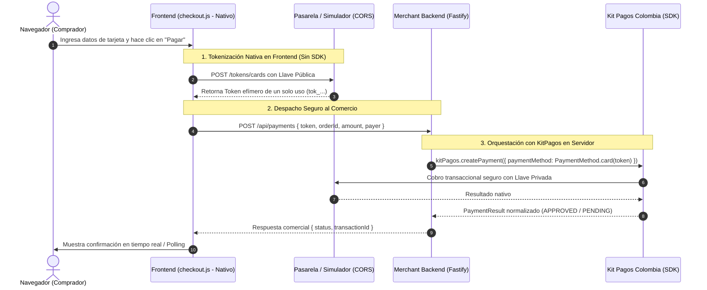

# Prototipo: Checkout con SDK Solo en Backend (Austral Mate)

Tienda de comercio electrónico especializada en **Hierbas de Mate y Accesorios de Origen**, que implementa la solución de **Kit Pagos Colombia exclusivamente en el Backend**.

---

## 🎯 Objetivo Arquitectónico en la Tesis

Este prototipo aborda la propuesta de valor central del proyecto de grado:
1. **El SDK vive exclusivamente en el servidor (Backend):** Toda la orquestación transaccional, resolución de adaptadores, normalización de montos, verificación de webhooks, consulta de estados y catálogo de bancos PSE se realiza utilizando `kit-pagos-colombia`.
2. **Frontend Nativo y Desacoplado:** El cliente web (`checkout.js`) **NO** importa `kit-pagos-colombia/browser`. Realiza la captura de tarjeta y tokenización llamando directamente a los endpoints públicos oficiales de cada pasarela (o al simulador en modo local) mediante `fetch` nativo.
3. **Soporte Completo de las 4 Pasarelas:**
   - **Wompi (Bancolombia):** Tokenización nativa de tarjeta y débito bancario PSE.
   - **Mercado Pago:** Tokenización nativa de tarjeta (con validación de documento de identidad) y PSE.
   - **Kushki:** Tokenización nativa de tarjeta y Transfer In.
   - **Rapyd:** Checkout alojado (Hosted Page) con redirección.

---

## 🌿 Flujo de la Transacción



---

## 🚀 Cómo Ejecutarlo

### 1. Requisitos Previos
Tener el SDK de Kit Pagos compilado:
```bash
cd sdk
npm run build
```

Si deseas probar contra el simulador local:
```bash
cd simulator-api
npm run dev # Escuchando en http://localhost:3000
```

### 2. Instalar y Correr el Prototipo
```bash
cd prototypes/checkout-con-sdk-solo-back
npm install
npm run dev # Escuchando en http://localhost:4200
```

Abre tu navegador en [http://localhost:4200](http://localhost:4200).

---

## 🧪 Pruebas Automatizadas

```bash
# Ejecutar suite de pruebas con Jest
npm test

# Cobertura de código
npm run test:coverage

# Verificación de tipos TypeScript
npm run typecheck
```

### Prueba de Límite Arquitectónico
La prueba `test/no-browser-sdk.test.ts` valida estáticamente que el script `src/public/checkout.js`:
- No contiene ninguna importación de `kit-pagos-colombia/browser`.
- Ejecuta las peticiones nativas directas de tokenización hacia cada pasarela.
- Garantiza la estricta separación de responsabilidades requerida por la metodología de evaluación.
